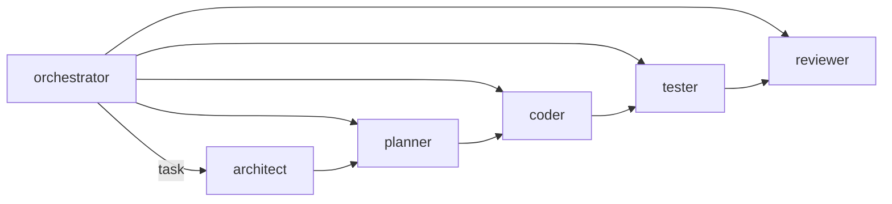

# Guía de Authoring de Agentes

Cómo crear agentes para el harness SDD (runtime OpenCode).

## 1. Ubicación y registro

```text
.opencode/agents/
├── orchestrator.md    # agente primario (punto de entrada)
├── architect.md
├── planner.md
├── coder.md
├── tester.md
└── reviewer.md
```

- Un archivo por agente; se cargan automáticamente desde `.opencode/agents/`.
- `opencode.json` fija `default_agent: "orchestrator"`.
- Registrar el agente en la tabla **Matriz de Agentes** de
  [`AGENTS.md`](../AGENTS.md) (sub-comando, modelo, mode, rol).
- Si el agente participa de un workflow, crear un slash command en
  `.opencode/commands/` (`description` en frontmatter + instrucciones).

## 2. Frontmatter

```yaml
---
name: reviewer
description: Auditoría de seguridad, calidad de código y adherencia a la especificación.
model: opencode-go/glm-5.3-flash
temperature: 0.1
mode: subagent
permission:
  read:
    src/*: allow
    tests/*: allow
  edit: deny
  bash:
    cargo fmt --check: allow
    cargo clippy *: allow
    "*": deny
  task: deny
---
```

| Campo | Regla |
|-------|-------|
| `name` | identificador corto (`snake_case`); coincide con el `@nombre` |
| `description` | una frase de rol; guía al orquestador en el enrutado |
| `model` | proveedor/modelo asignado (ver §4) |
| `temperature` | baja (0.0–0.2) para tareas deterministas; `tester` = `0.0` |
| `mode` | `primary` (agente de entrada) o `subagent` (invocado vía `task`) |
| `permission` | mapa de permisos por herramienta — **principio de mínimo privilegio** |

### Permisos

- `read` / `glob` / `grep`: rutas con `allow` explícito.
- `edit`: `deny` para agentes que no escriben (orchestrator, reviewer).
- `bash`: lista explícita de comandos con wildcard; **terminar con
  `"*": ask`**, nunca con `"*": deny` (ver la nota de free tier más abajo).
  Ej.: reviewer solo `cargo fmt/clippy/test` y `git status/diff/log` de solo
  lectura.
- `task`: `deny` salvo el orquestador (único que invoca subagentes).

### Permisos y free tier de OpenCode Zen — `"*": deny` rompe el free tier

**Regla dura: ningún agente del harness debe terminar su bloque `bash` con
`"*": deny`. Usar `"*": ask`.**

Los modelos gratuitos de OpenCode Zen (`opencode/*`) rechazan la sesión con
`AI_APICallError: OpenCode's free tier can only be used from within OpenCode`
cuando el agente que atiende el request trae un array de herramientas
restringido — un bloque de `permissions` que deniega `bash`. El gate del
free tier confunde "agente con permisos restricted" con "cliente fuera de
OpenCode" y corta antes del primer tool call. Reportado upstream:

- [anomalyco/opencode#50627](https://github.com/anomalyco/opencode/issues/50627) — `deny shell *` en agente primary rompe el free tier.
- [anomalyco/opencode#53347](https://github.com/anomalyco/opencode/issues/53347) — agente primary custom denegado mientras el `plan` built-in funciona con el mismo modelo.
- [anomalyco/opencode#49680](https://github.com/anomalyco/opencode/issues/49680) — mismo error en subagentes y en `compaction`/`title`.

Síntoma característico: el mismo modelo funciona en `build`/`plan` (built-in,
sin bloque `permissions`) y falla en el agente custom. **No es un problema de
modelo** — cambiar de modelo no lo arregla.

Mitigación hasta que se corrija upstream: `"*": ask` en lugar de `"*": deny`.
Se conserva el control de acceso (todo comando no listado requiere
aprobación explícita del usuario) sin disparar el bug.

## 3. Cuerpo del agente

Estructura canónica (ver `.opencode/agents/reviewer.md`):

1. **Role** — quién es y qué hace.
2. **Input** — artefactos de entrada con rutas exactas.
3. **Responsabilidades** — lista numerada.
4. **Checklist** — casillas verificables agrupadas por categoría.
5. **Quality Gates** — comandos exactos a ejecutar.
6. **Output** — forma del resultado.
7. **Output Contract** — contrato JSON estricto del dictamen/entregable.

Reglas:

- todo camino de archivo es concreto (`.docs/02-…`, `.sdd/tasks/`);
- los gates son los del workspace: `cargo fmt --all -- --check`,
  `cargo clippy --workspace --all-targets -- -D warnings`,
  `cargo test --workspace`;
- el output contract impide respuestas ambiguas entre agentes.

## 4. Asignación de modelos (matriz actual)

| Agente | Sub-comando | Modelo por defecto (GRATIS) | Alternativa de pago (manual) | Mode |
|--------|-------------|-----------------------------|------------------------------|------|
| orchestrator | `/orchestrate` | `opencode/longcat-2.5-preview-free` | `opencode-go/qwen3.7-plus` | primary |
| architect | `/plan` | `opencode/nemotron-3-ultra-free` | `opencode-go/kimi-k3` | subagent |
| planner | `/tasks` | `opencode/ling-3.0-flash-fin-free` | `opencode-go/qwen3.7-plus` | subagent |
| coder | `/implement` | `opencode/big-pickle` | `opencode-go/kimi-k2.7-code` | subagent |
| tester | `/test` | `opencode/nemotron-3.5-lightning-free` | `opencode-go/deepseek-v4.1-flash` | subagent |
| reviewer | `/review` | `opencode/muse-spark-1.3-contributor-free` | `opencode-go/glm-5.3-flash` | subagent |

Criterio: orquestación → ventana de contexto grande (1M para mantener el
estado del ciclo + salidas de subagentes); arquitectura → rigor lógico +
contexto; planificación → estructuración y formato; implementación → modelo
validado en código real; verificación → modelos rápidos; review → contexto
amplio para auditar diff + spec.

### 4.1 Modelos gratuitos vs de pago

Los 8 modelos gratuitos disponibles (`opencode/*`, `$0/Mtok` en OpenCode Zen):

| Modelo | ctx | output | Rol recomendado |
|--------|-----|--------|-----------------|
| `longcat-2.5-preview-free` | 1.0M | 131K | orquestación, lectura de repo grande (**preview**) |
| `nemotron-3-ultra-free` | 1.0M | 128K | arquitectura y auditoría (mayor rigor) |
| `muse-spark-1.3-contributor-free` | 1.05M | 131K | review con contexto grande; ideación |
| `space-bunny-free` | 1.05M | 524K | respaldo de contexto/output grande |
| `ling-3.0-flash-fin-free` | 262K | 32K | planificación, estructuración de tablas/reglas |
| `nemotron-3.5-lightning-free` | 262K | 262K | QA rápido, linter-like |
| `big-pickle` | 200K | 32K | codificación, brainstorming |
| `mimo-v2.6-flash-free` | 200K | 32K | `small_model`: títulos/resúmenes/compactación |

Reglas:

1. **El sufijo `-free` no prueba gratuidad**: `deepseek-v4.1-flash` y
   `muse-spark-1.3` son de pago; `big-pickle` es gratis. Verificar con
   `opencode models -v` (costos) o models.dev.
2. **Defaults = gratis** en `.opencode/agents/*.md` y `opencode.json`;
   los de pago se eligen a mano con `/models` (nada está deshabilitado).
3. `model`/`small_model` en `opencode.json` cubren los built-in
   (`build`/`plan`) y las tareas ligeras (títulos, compactación).
4. Los modelos gratuitos pueden cambiar o retirarse (los `*-preview-*` con
   más frecuencia): documentar siempre un respaldo por rol (p. ej.
   `space-bunny-free` para contexto grande).
5. Los sustitutos gratuitos "de familia" (`qwen3.6-plus-free`,
   `kimi-k2.5-free`, `glm-5-free`, `deepseek-v4-flash-free`) existen en
   models.dev pero **no están habilitados** en esta instalación; si
   aparecen en `opencode models`, son los primeros candidatos por
   continuidad de familia.

**Brainstorming (rol sin agente propio):** la fase de ideación la ejecuta
el `orchestrator`; si se dispara a mano, usar `opencode/big-pickle`
(versatilidad, sin sesgo estructural) o
`opencode/muse-spark-1.3-contributor-free` (desglose conceptual).

### 4.2 Fallback de modelos por pasos (agnóstico al proveedor)

OpenCode **no soporta fallback automático de modelos por agente**: no existe
una lista de modelos priorizados que el runtime recorra ante un fallo
(rate limit, cuota, error de proveedor). El framework implementa su propio
sistema, sin ataduras al host:

1. **Cadenas por rol** en `.sdd/config/models.json` (plantilla instalada por
   `sdd init`): cada rol tiene su cadena ordenada — el primer elemento es el
   modelo fijado en el frontmatter del agente — y terminada en `inherit`,
   que quita el pin para seguir el modelo global activo del host.
2. **Probe agnóstico**: `sdd model health` / `sdd model fallback` prueban
   cada modelo con HTTP genérico (`openai-chat-completions` o
   `anthropic-messages` según `providers.<id>.request_style`), con
   credenciales desde env o archivo JSON (nunca literales en config).
   Funciona con cualquier proveedor que hable esos protocolos.
3. **Write-back por rol**: el fallback escribe `model:` en
   `.opencode/agents/<rol>.md` (atómico: temp + rename) y registra en
   `.sdd/config/model-health.json`. Si todo falla: exit ≠ 0 con cada error
   observado y **nada se escribe**.
4. **Reanudación garantizada**: el fallback no toca tareas, código ni git.
   Lo avanzado se retoma con `sdd status` (la tarea sigue `IN_PROGRESS`).
5. **Auto-resolución al arrancar**: el orquestador ejecuta
   `sdd model health --role orchestrator` al iniciar sesión; si está caído,
   ejecuta el fallback y anuncia el cambio. Un fallo *mid-sesión* requiere
   `/model-fallback` manual + reinicio de sesión (el host no expone hooks de
   error de modelo).
6. **Fallos nunca silenciosos**: el orquestador informa en voz alta modelo +
   error + siguiente sugerido. Un harness que falla en silencio pierde su
   sentido.
7. **Pin = cabeza de cadena**: el `model:` de cada agente y el primer
   elemento de su cadena son un solo contrato (test
   `test_agent_pins_match_chain_heads` en `sdd-storage`).

## 5. Flujo entre agentes



- Solo el `orchestrator` tiene `task: allow` (invoca subagentes).
- El `coder` escribe; `orchestrator` y `reviewer` tienen `edit: deny`.
- Las skills cargadas por el agente (§6) refuerzan workflow y convenciones.

## 6. Skills vinculadas

| Agente | Skills habituales |
|--------|-------------------|
| todos | `sdd-task-workflow`, `branching-sdd` |
| coder | `cargo-workspace`, `conventional-commits`, `rust-quality` |
| tester / reviewer | `rust-quality`, `conventional-commits` |

Ver [guía de skills](skill-authoring.md).

## 7. Checklist de autoría

- [ ] frontmatter completo (`name`, `description`, `model`, `mode`, `permission`);
- [ ] mínimo privilegio: `edit: deny` si no escribe; bash con `"*": deny` final;
- [ ] input/output con rutas y contratos concretos;
- [ ] quality gates del workspace incluidos;
- [ ] matriculado en `AGENTS.md`;
- [ ] slash command asociado si tiene sub-comando;
- [ ] modelo asignado según la matriz y temperatura coherente con el rol.
