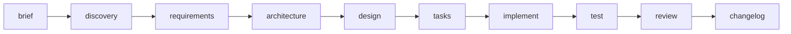

# Guía de Usuario — SDD AI Development Harness

Guía práctica para llevar un proyecto desde cero usando el framework SDD.

## 1. Requisitos

- Rust **1.80+** (MSRV; edition 2021)
- Git
- Un agente de IA compatible con OpenCode (para el flujo con agentes) — ver
  [authoring de agentes](agent-authoring.md)

## 2. Instalación

```bash
# Instalar el binario globalmente desde GitHub
cargo install --git https://github.com/cemansilla/framework-sdd sdd-cli
sdd --version        # sdd 0.1.0

# O compilar desde el repositorio
git clone https://github.com/cemansilla/framework-sdd
cd framework-sdd
cargo build --release
export PATH="$PWD/target/release:$PATH"
```

## 3. Inicializar un proyecto

```bash
mkdir mi-proyecto && cd mi-proyecto
sdd init
```

Esto crea:
- La estructura `.sdd/` con plantillas editables y un `manifest.json` cuyo
  `project_id` se deriva del nombre del directorio.
- Los archivos de proyecto que define el harness: `AGENTS.md`, `.opencode/`
  (agentes, comandos y skills) y `.gitignore`.

Propiedades de `sdd init`:

- **Idempotente**: re-ejecutarlo no destruye contenido existente (solo crea
  archivos que falten).
- Siempre puede reconstruir las plantillas perdidas sin tocar artefactos
  del usuario.

### Actualizar los archivos de proyecto

Al actualizar el framework conviene refrescar los archivos de proyecto para
adoptar los agentes y skills de la nueva versión:

```bash
cargo install --git https://github.com/cemansilla/framework-sdd sdd-cli --force
sdd init --update
```

`sdd init --update` sobrescribe `AGENTS.md`, `.opencode/` y `.gitignore` con
las plantillas de la versión instalada. Los artefactos del usuario en `.sdd/`
nunca se modifican.

## 3b. Modelos y fallback (agnóstico al proveedor)

Cada rol tiene su cadena ordenada de modelos en
`.sdd/config/models.json`, terminada en `inherit` (seguir el modelo global
activo del host). El sistema es del framework, no del proveedor: las cadenas
son `proveedor/modelo` y el probe es HTTP genérico.

```bash
sdd model status                    # ver cadenas y última salud (sin red)
sdd model health --role orchestrator # probar el modelo actual del rol
sdd model health --all              # probar todos los roles
sdd model fallback --role coder     # fijar el primer modelo sano
sdd model report --role coder -e "429 rate limit"  # registrar un fallo visto
```

Reglas:

- El fallback **solo** escribe `.opencode/agents/<rol>.md` (el `model:`) y
  `.sdd/config/model-health.json`. Tareas, código y git quedan intactos: lo
  avanzado se reanuda con `sdd status`, no se rehace.
- Orden de selección: primero sano verificado; si nada es verificable
  (típico del free tier, cuya puerta solo admite sesiones vivas), rota al
  siguiente de la cadena **diciéndolo explícitamente**; `inherit` es el
  último recurso (quita el pin).
- Si la cadena se agota sin nada sano, el comando sale con error, lista cada
  fallo y **no escribe nada**. Nunca hay degradación silenciosa.
- El orquestador verifica su salud al iniciar cada sesión y se auto-recupera
  solo ante un fallo **verificado**; ante `UNTESTABLE` avisa y sigue. Un
  fallo en mitad de sesión se recupera con `/model-fallback` (o el comando)
  + reinicio de sesión: el host no expone hooks de error de modelo.
- Credenciales por variable de entorno o archivo JSON (ver `providers` en
  `models.json`); nunca literales en config versionada. Sin credencial
  utilizable, el probe informa `UNTESTABLE` en vez de inventar un fallo.

## 4. Flujo de trabajo SDD



| Fase | Artefacto en `.sdd/` | Herramienta |
|------|----------------------|-------------|
| Brief | `brief/brief.md` | plantilla de `sdd init` |
| Discovery | `discovery/{questions,assumptions,risks}.md` | plantillas |
| Requisitos | `requirements/REQ-*.md` | agente `@planner` o manual |
| Arquitectura | `architecture/architecture.md`, `architecture/adr/` | agente `@architect` |
| Diseño | `design/` | agente `@architect` |
| Tareas | `tasks/TASK-*.md` | agente `@planner` (comando `/tasks`) |
| Implementación | código + `tasks/TASK-*.md` actualizado | agente `@coder` (`/implement`) |
| Testing | `tests/` + código | agente `@tester` (`/test`) |
| Review | dictamen | agente `@reviewer` (`/review`) |
| Cambios | `changes/CHANGELOG.md`, `changes/CHG-*.md` | `sdd changelog` + agentes |

La matriz completa de agentes, modelos y comandos está en
[`AGENTS.md`](../AGENTS.md).

## 5. Comandos para el día a día

```bash
sdd status                  # estado real de los artefactos
sdd validate                # validación estricta (exit 1 ante errores)
sdd changelog               # historial de cambios con trazabilidad
sdd changelog -p ../otro    # operar sobre otro proyecto
```

`validate` distingue:

- **errores** (exit 1): manifest inválido, o `brief.md`,
  `architecture.md`, `CHANGELOG.md` o `config/project.md` faltantes/vacíos;
- **advertencias** (exit 0): `requirements/` o `tasks/` sin archivos `.md`.

> Los demás comandos (`brainstorm`, `requirements`, `tasks`, `context`,
> `implement`, `test`, `review`, `change`, `impact`, `hooks`) son stubs en
> v0.1.0: imprimen orientación pero no persisten. El detalle y el estado de
> cada uno está en la [referencia CLI](cli-reference.md).

## 6. Registro de cambios

Todo cambio relevante (requisito, arquitectura, diseño, fix) se registra en
`.sdd/changes/CHANGELOG.md` bajo `## [Unreleased]`:

```markdown
### [CHG-001] 2026-09-26 — Título del cambio

- **Motivo**: por qué cambia
- **Origen**: feature | change | fix
- **Artefactos afectados**: rutas
- **Impacto**: qué cambia
- **Tareas afectadas**: TASK-*
```

Los registros individuales con análisis de impacto viven en
`.sdd/changes/CHG-*.md`. `sdd changelog` los lista por pantalla.

## 7. Integración con agentes de IA

El harness se usa desde OpenCode con los agentes definidos en
`.opencode/agents/` y las skills en `.opencode/skills/`. El punto de entrada
es el comando `/orchestrate`.

**Modelos:** los agentes usan por defecto modelos **gratuitos** de OpenCode
Zen (`opencode/*-free`, $0/Mtok); los modelos de pago se eligen a mano con
`/models` sin cambiar nada en el repo. La matriz rol → modelo (gratis vs
pago) está en [`AGENTS.md`](../AGENTS.md) y
[authoring de agentes](agent-authoring.md#4-asignación-de-modelos-matriz-actual).

Ver:

- [Agentes e integraciones](agents-integrations.md)
- [Authoring de agentes](agent-authoring.md)
- [Authoring de skills](skill-authoring.md)

## 8. Solución de problemas

| Síntoma | Causa probable | Solución |
|---------|----------------|----------|
| `✗ No SDD project found` | no existe `.sdd/` | `sdd init` |
| `validate` exit 1 | artefacto requerido faltante/vacío | crear el archivo indicado |
| `status` muestra ✗ | directorio sin contenido | agregar archivos `.md` |
| Manifest inválido | `manifest.json` corrupto | restaurar desde Git |
